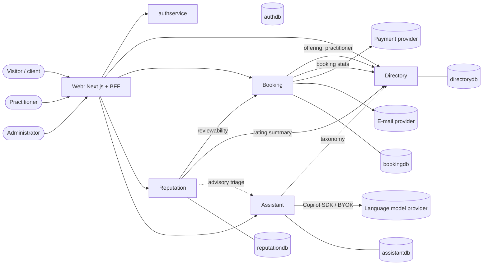

# Gabinety Tech — System specification

> Normative description of what is built. Tasks are in [`TASKS.md`](TASKS.md), the execution protocol in
> [`SUPERVISOR.md`](SUPERVISOR.md), measured state in [`PROGRESS.md`](PROGRESS.md), owner decisions in [`DECISIONS.md`](DECISIONS.md).
> Data models, HTTP contracts, state machines and formulas are in [`CONTRACTS.md`](CONTRACTS.md); the LLM gateway in
> [`COPILOT-SDK.md`](COPILOT-SDK.md). The business input is [`../research/BUSINESS-ANALYSIS.md`](../research/BUSINESS-ANALYSIS.md) (Polish).
>
> Rules for writing this file:
> - Every section answers its questions or says `n/a` with a reason. An empty heading is not an answer.
> - Architecture rules are **not** restated here. They live in
>   [`architecture-standards`](https://github.com/konradcinkusz/architecture-standards) (P1–P15); this file says only what is
>   specific to this system and where it deviates.
> - A statement an agent could not check ("fast", "secure", "simple") is replaced by a number or an observable condition.
> - Anything assumed and not verified is written as an assumption and listed in §12.

## 0. Glossary

| Term | Meaning in this system |
|---|---|
| Gabinet | A practitioner's public profile and calendar: the place where one programmer sells consultations. "Gabinety AI" in the business analysis means gabinets of solo programmers who work with AI. One person, one gabinet |
| Practitioner | A programmer with a gabinet (`practitioners` row, Directory) |
| Client | Any signed-in user who books a consultation. A user can be both |
| Consultation | A paid video meeting of 30 or 60 minutes at a fixed price, booked in a slot of the practitioner's calendar. The only product of the MVP |
| Offering | A consultation product of a practitioner: title, duration, price, problem category |
| Slot | A start time at which an offering can be booked (CONTRACTS §9.4) |
| Brief | The client's description of the problem, entered when booking; at most 2000 characters |
| First consultation | The first money-completing consultation between one client and one practitioner; the only one that carries the platform fee (ADR-0008) |
| Verified review | A review written by the client of a booking that completed, once; the only kind there is |
| Ranking rules | The published formula that orders practitioners (CONTRACTS §9.3), versioned |
| Assistant | The service that wraps the language model (`Gabinety.Assistant`); optional |
| Director / supervisor | The session that coordinates the work (SUPERVISOR.md). Used as synonyms |
| Leakage | The client and practitioner continuing outside the platform after the first meeting |
| Fake profile | The way of running the whole system with no Docker, no account and no credentials (§4.1) |

## 1. Goals and non-goals

### 1.1 Goals

Each goal is observable on the fake profile at M1 and on staging at M2.

1. **Discover.** A visitor with no account opens `/programisci/migracja-legacy-dotnet` and sees a list of approved practitioners ordered by the published rules, each with price, badges and, from three reviews, a rating; the page is server-rendered HTML that contains the list without running JavaScript.
2. **Trust.** A practitioner profile shows which verifications passed (e-mail, GitHub, NIP, administrator approval) and shows only reviews of consultations that took place through the platform.
3. **Book.** A signed-in client picks a free slot of a practitioner's offering, describes the problem, pays, and sees the meeting link and a confirmation; the practitioner is notified; the slot cannot be taken by anyone else (CONTRACTS §4.1).
4. **Get paid fairly.** After the consultation and the dispute window the practitioner's payout is calculated by the published rule; the platform fee exists only on the first consultation of a pair.
5. **Review.** After a completed consultation the client leaves one review; it appears after deterministic checks (and an advisory model check when available); the practitioner may reply once, and cannot delete it.
6. **Onboard.** A programmer creates a gabinet, links GitHub, enters a NIP, adds offerings and a weekly calendar, submits it, and an administrator approves it in a queue.
7. **Be helped by AI, optionally.** A client may paste a free-text problem and receive a suggested category, technologies, a short summary and up to three clarifying questions; with the Assistant unavailable the same booking works with a plain form.
8. **Operate.** The owner can see disputes, held reviews, the verification queue and a CSV of the ledger, and can see what is degraded from one `/health` request per service.

### 1.2 Non-goals

Copied from DECISIONS D-03 and extended. A task that serves one of these is rejected.

- Scraping, copying or reusing profiles, reviews, texts, images or branding of ZnanyLekarz or any other site, including as test data.
- Hosting video, chat, or file exchange between the parties.
- Project work: quotes, contracts, milestones, escrow, invoicing automation, subscriptions (Pro). They are the retention answer to leakage (BUSINESS-ANALYSIS §5) and come after the MVP.
- Paid placement, promotion or any input to ranking that can be bought.
- Native apps, several languages, several currencies, teams and agencies.
- Letting a language model decide anything about money, ranking, ratings, verification, or removal of content (§5 rule 6).
- Running public traffic on the owner's Copilot subscription (ADR-0004).
- Analytics, advertising or any third-party script on public pages in the MVP.
- Calendar sync with external calendars, instant messaging, reminders by SMS.

## 2. System context



| Party | Role | Data in | Data out |
|---|---|---|---|
| Visitor, client, practitioner, administrator | Humans in a browser | Credentials (to authservice only), profile text, briefs, reviews, availability, payments (card data goes to the payment provider, never to this system) | Pages, e-mails |
| authservice | Identity provider (ADR-0002) | Credentials, consents | Tokens, JWKS |
| Payment provider | Takes the client's money, splits it, refunds | Checkout requests, refund and payout requests | Signed webhooks |
| E-mail provider | Transactional e-mail | Message bodies | Delivery status (not used in the MVP) |
| Language model provider | Optional advice | Brief and review text, system prompts | Replies, usage |
| Search engines | Crawl public pages | — | Traffic |

## 3. Repository

### 3.1 Name and derived names

| Thing | Name |
|---|---|
| Repositories | spec: `gabinety-tech-spec`; code: `gabinety-tech` (DECISIONS D-01, ADR-0009) |
| Solution | `GabinetyTech.sln` |
| AppHost / ServiceDefaults | `Gabinety.AppHost` / `Gabinety.ServiceDefaults` |
| Image prefix | `ghcr.io/konradcinkusz/gabinety-` (`-directory`, `-booking`, `-reputation`, `-assistant`, `-web`) |
| Fly apps | `gabinety-<service>-staging` |
| C# root namespace | `Gabinety.<Project>` |

### 3.2 Tree

```
global.json  Directory.Build.props  Directory.Packages.props  .editorconfig  GabinetyTech.sln
src/
  Gabinety.AppHost/          composition root: PostgreSQL (or InMemory), authservice, services, web; profile `fake`
  Gabinety.ServiceDefaults/  kernel: OpenTelemetry, /health and /alive, problem details, JWT validation, internal-key auth,
                             rate limiting, service discovery (<= 400 lines of C#, no domain)
  Gabinety.Contracts/        DTOs that cross an HTTP boundary (records, no logic, no EF); the OpenAPI source of truth for the web types
  Gabinety.Billing/          PURE: Money, fee, refund and payout rules, booking state machine
  Gabinety.Scheduling/       PURE: slot generation (CONTRACTS §9.4)
  Gabinety.Ranking/          PURE: ranking and display rules (CONTRACTS §9.3)
  Gabinety.Llm/              ILlmGateway, CopilotLlmGateway, FakeLlmGateway. The ONLY project that references GitHub.Copilot.SDK
  Gabinety.Directory/        service: practitioners, offerings, taxonomy, verification, search, sitemap data
  Gabinety.Booking/          service: availability, bookings, payments (IPaymentProvider, Mock), ledger, payouts, notifications
  Gabinety.Reputation/       service: reviews, moderation, rating summaries
  Gabinety.Assistant/        service: brief assistant, review triage, usage and budget (references Gabinety.Llm)
web/                         Next.js app (App Router, TypeScript, pnpm): public pages, app pages, BFF routes, i18n
tools/Gabinety.DevIdentity/  dev-only identity stand-in for the fake profile (ADR-0003); referenced by nothing under src/
tests/
  Gabinety.Billing.Tests/  Gabinety.Scheduling.Tests/  Gabinety.Ranking.Tests/  Gabinety.Llm.Tests/
  Gabinety.Directory.Tests/  Gabinety.Booking.Tests/  Gabinety.Reputation.Tests/  Gabinety.Assistant.Tests/
  Gabinety.Architecture.Tests/   SDK isolation, public surface, kernel purity, project references, DevIdentity isolation
  Gabinety.Integration.Tests/    tier=integration: real PostgreSQL (Testcontainers), real authservice image
  e2e/                           Playwright journeys on the fake profile (TypeScript)
deploy/fly/                  one fly.toml per app, authservice and PostgreSQL included
docs/  spec/ adr/ research/ spikes/ operations/ ux/   (architecture/ is created by the Phase 0 scaffold if the standards' playbook asks for it)
scripts/                     check-spec.sh, check-open-markers.sh, dev-setup.sh, smoke-llm.sh (owner only, refuses CI), measure-performance.sh (T-10.04)
```

Allowed project references: `Billing`, `Scheduling`, `Ranking`, `Llm`, `Contracts` reference no project. `Directory` → ServiceDefaults, Contracts, Ranking. `Booking` → ServiceDefaults, Contracts, Billing, Scheduling.
`Reputation` → ServiceDefaults, Contracts. `Assistant` → ServiceDefaults, Contracts, Llm. `AppHost` → every service. Tests may reference what they test. Any other edge is a review finding (architecture test).

Dependency budget:

| Project | Allowed packages |
|---|---|
| Billing, Scheduling, Ranking, Contracts | none |
| Llm | `GitHub.Copilot.SDK` |
| ServiceDefaults | `OpenTelemetry.*`, `Microsoft.Extensions.ServiceDiscovery`, `Microsoft.Extensions.Http.Resilience`, `Microsoft.AspNetCore.Authentication.JwtBearer` |
| Directory, Booking, Reputation, Assistant | EF Core, `Npgsql.EntityFrameworkCore.PostgreSQL`, `Microsoft.EntityFrameworkCore.InMemory` (development and tests), `Microsoft.AspNetCore.OpenApi`. `Microsoft.EntityFrameworkCore.Design` is tooling only |
| AppHost | `Aspire.Hosting.AppHost`, `Aspire.Hosting.PostgreSQL`, `Aspire.Hosting.NodeJs` (or the current Aspire JavaScript hosting package) |
| tests | xUnit, `Microsoft.AspNetCore.Mvc.Testing`, `Microsoft.Extensions.TimeProvider.Testing`, `Testcontainers.PostgreSql` |
| web | `next`, `react`, `react-dom`, `typescript`, `jose` (JWT verification in middleware); dev: `eslint`, `vitest`, `@playwright/test`, `@axe-core/playwright`, `openapi-typescript`. No UI kit, no state library, no CSS framework, no analytics |

A package outside this table is requested by the implementer in the PR description and added by the supervisor (SUPERVISOR §4).

## 4. Runtime topology

### 4.1 Development (P1: Aspire AppHost is the composition root)

| Resource | Kind | Depends on | Health | Port |
|---|---|---|---|---|
| `postgres` | container, volume `gabinety-pg` (default profile only) | — | TCP | 5432 |
| `authservice` | container, pinned image of `konradcinkusz/authservice` (default profile only; tag recorded by T-01.01) | `postgres` (`authdb`) | `/health` (A-01) | 5105 |
| `devidentity` | project `tools/Gabinety.DevIdentity` (fake profile only) | — | `/health` | 5100 |
| `directory` | project | `postgres` (`directorydb`) | `/health`, `/alive` | 5101 |
| `booking` | project | `postgres` (`bookingdb`), `directory` | `/health`, `/alive` | 5102 |
| `reputation` | project | `postgres` (`reputationdb`), `directory`, `booking` | `/health`, `/alive` | 5103 |
| `assistant` | project | `postgres` (`assistantdb`), `directory` (optional) | `/health`, `/alive` | 5104 |
| `web` | Next.js app, started by the AppHost | all services, the identity provider | `/api/health` | 3000 |

Services wait for what they need to start (`WaitFor`) and **never** for the Assistant, the payment provider or e-mail (P8). The fixed ports above are
fixed because documentation, the e2e tests and the OAuth redirect of the real authservice refer to them (P1).

**Default profile** (`dotnet run --project src/Gabinety.AppHost`): PostgreSQL and authservice in Docker, `Payments:Provider=Mock`, `Notifications:Provider=Log`, and the
Assistant on whatever `Llm:Provider` the user secrets say (default `Copilot`, which degrades to `Unavailable` without a login).

**Fake profile** (`dotnet run --project src/Gabinety.AppHost --launch-profile fake`, sets `GABINETY_FAKE=1`): no Docker, no credentials, no network: `Llm:Provider=Fake`,
`Database:Provider=InMemory`, `Payments:Provider=Mock`, `Notifications:Provider=Log`, the DevIdentity stand-in as identity provider, demo data seeded through the APIs (§7).
This is the profile of every implementer session, of the e2e job and of gate M0 and M1. Nothing done in it survives a restart.

### 4.2 Without Aspire

n/a. DECISIONS D-06: no `docker compose` file. The AppHost is the single way to start the system for a gate. (The CI `integration` job starts the real authservice image
and PostgreSQL as containers directly, because it tests those, not the AppHost.)

### 4.3 Deployed (P7, DECISIONS D-07)

Fly.io, region `fra`, environment `staging`. Sizes are starting points, measured and corrected in T-09.02.

| App | Public listener | Size | `min_machines_running` | State |
|---|---|---|---|---|
| `gabinety-web-staging` | yes, the only one besides the webhook path | shared-cpu-1x, 512 MB | 1 (on the synchronous path of every page) | none |
| `gabinety-directory-staging` | no (private network, `.flycast`/`.internal`) | shared-cpu-1x, 512 MB | 1 (called in-request by the web app and Booking) | `directorydb` |
| `gabinety-booking-staging` | the webhook path only | shared-cpu-1x, 512 MB | 1 (in-request, and it runs the jobs) | `bookingdb` |
| `gabinety-reputation-staging` | no | shared-cpu-1x, 256 MB | 1 (the push and triage retries are jobs) | `reputationdb` |
| `gabinety-assistant-staging` | no | shared-cpu-1x, 1024 MB (the Copilot runtime, A-05) | 0 (optional; the first call after idle may degrade to the plain form, accepted) | `assistantdb` |
| `gabinety-authservice-staging` | yes (login, OAuth callback, JWKS) | shared-cpu-1x, 512 MB | 1 (every service fetches the JWKS from it) | `authdb` |
| `gabinety-postgres-staging` | no | shared-cpu-1x, 1 GB, volume 5 GB, `PGDATA` subdirectory | 1 | one instance, five databases, created by one init script |

Cost is reasoned about in `docs/operations/COST.md` (T-09.02) before the first deploy and re-checked at M2. Backups: a daily dump of every database to object storage and a restore test (T-10.05).

## 5. Cross-cutting rules (apply to every task)

1. **Language.** Code, comments, docs, commit messages and PR text in English. All user-facing text in Polish, in one place per surface (`web/src/i18n/pl.ts`, `src/Gabinety.Booking/Notifications/Templates/`). No Polish string literal in a component or a service outside those.
2. **Privacy of free text.** A brief, a review, a bio and an offering text are user content. They are never written to a log, a trace, a metric or an exception message; code logs lengths, ids and hashes. An analyzer-style test greps the source for logging calls that take those fields (`Gabinety.Architecture.Tests`).
3. **Money** is `long` minor units plus a currency, wrapped in `Money`. No `double`, `float` or `decimal` in money arithmetic, and no rounding except the one defined in CONTRACTS §9.1.
4. **Time** is UTC in storage and on the wire; code reads `TimeProvider`, never `DateTime.UtcNow`; tests use `FakeTimeProvider`. A grep guard forbids `DateTime.Now`, `DateTime.UtcNow` and `DateTimeOffset.UtcNow` outside the composition root.
5. **One database per service** (P3). No service opens another's connection. Reads across services go through the contracts of CONTRACTS §3.6, §4.3, §5.2.
6. **Models advise; they never decide.** A model output never changes money, ranking, ratings, verification status, or removes content. Its absence never blocks a person: every feature that uses it has a working path without it (P8). The model's text is data: it is validated against a schema, it is never rendered as HTML, it never reaches another model's prompt unescaped, and a model has no tools (COPILOT-SDK R6).
7. **Optional dependencies degrade visibly** (P8): Assistant (plain form), e-mail (log, banner for the administrator), a down payment provider (booking is disabled with a message; browsing is not), Directory unavailable to Booking (new bookings refused, existing ones unaffected). `/health` of each service reports every optional dependency by name with `Healthy`, `Degraded`, never `Unhealthy` for an optional one; the startup banner prints the same list.
8. **Idempotent writes.** A write that can be retried carries an idempotency key or is naturally idempotent (a monotonic-version `PUT`). A write that is not idempotent is never retried automatically.
9. **Contracts do not drift.** Each service exports OpenAPI; `web/` generates its types with `openapi-typescript`; CI fails when the committed types differ from a fresh generation (task T-07.01).
10. **Secrets.** None in source, config files, comments or fixtures; a scanner runs in pre-commit and CI (REPO-BASELINE). Configuration through environment variables, secrets through AppHost secret parameters locally and `fly secrets` deployed. The signing key exists only in authservice.
11. **Authorization is on the server**, in the service that owns the data, by policy (not by `if` in a handler). The web app hides what a user may not do; it does not enforce it.
12. **Cross-site writes are refused** by the web app and by every service that accepts a browser: foreign `Origin` or `Sec-Fetch-Site: cross-site` on `POST`, `PUT`, `DELETE`, `PATCH` answers 403 `cross_site_request` (test in each).
13. **The public site has no third-party script** and no cookie banner is needed for it; the only cookies are the session cookies of signed-in users (strictly necessary). Adding analytics needs an ADR.
14. **Accessibility baseline** (WCAG 2.1 AA, the part a test can check): every form control has a label, every page has one `h1`, contrast of the design tokens meets 4.5:1, every interactive element is reachable and operable by keyboard. The e2e job runs axe on the pages of its journeys and fails on any violation of impact `serious` or `critical`.
15. **The ranking rules and the fee rule are the owner's.** A task never changes a constant of CONTRACTS §9.1 to §9.3 on its own (DECISIONS D-17).

### 5.1 Calls between components

Every call between two components states the longest time the callee may take under load and whether the caller may retry. A call without a row here is not allowed.

| Caller → callee | Operation | Timeout | Retry |
|---|---|---|---|
| Browser → web | any | platform default | n/a |
| Web → authservice | login, refresh, register, logout | 5 s | no for login and register; refresh once (single-use token: a repeated refresh after a timeout may fail and ends the session, which is the safe outcome) |
| Web → Directory | reads | 5 s | once, `GET` only |
| Web → Directory | writes (`PUT`, `POST`) | 10 s | no |
| Web → Booking | slots, reads | 5 s | once, `GET` only |
| Web → Booking | `POST /bookings` | 15 s | no automatic retry; the client may repeat the request with the **same** `Idempotency-Key` |
| Web → Reputation | reads | 5 s | once, `GET` only |
| Web → Assistant | `brief` | 35 s (the model's 30 s plus overhead and a cold start) | no |
| Booking → Directory | `GET /internal/v1/offerings/{id}` | 3 s | once |
| Booking → Directory | booking-stats `PUT` | 5 s | up to 3 times with backoff (monotonic version makes it idempotent) |
| Booking → payment provider | create checkout, refund, payout | 10 s | only with the provider's idempotency key, up to 2 times; without a key never |
| Booking → e-mail provider | send | 10 s | up to 5 attempts over 24 h from the `notifications` table |
| Reputation → Booking | reviewability | 3 s | once |
| Reputation → Assistant | triage | 25 s | no (the review is published without the model, CONTRACTS §5.3) |
| Reputation → Directory | reputation `PUT` | 5 s | up to 3 times in a row, then again on the next job run (monotonic version) |
| Assistant → Directory | taxonomy | 3 s | no; the cached value is used |
| Assistant → model | one reply | 30 s (`brief`), 25 s (`triage`) | the one repair attempt of CONTRACTS §6 is a second call; no other retry |

A timeout that proves wrong is fixed here and in the client together (SUPERVISOR §6), never by lengthening it only in code. A cold Fly machine
that is allowed to scale to zero (only the Assistant) is covered by the 35 s of the web call; for every other callee the `min_machines_running = 1` of §4.3 is the guarantee.

## 6. Services

### 6.0 Shared kernel (`Gabinety.ServiceDefaults`)

Responsibilities: `AddServiceDefaults()` (OpenTelemetry with OTLP when `OTEL_EXPORTER_OTLP_ENDPOINT` is set, health-check requests filtered from traces, `/health` and `/alive`, service discovery, the standard resilience handler on every `HttpClient`),
problem-details mapping to CONTRACTS §0, `AddJwtAuthentication` (validates against the JWKS of `Identity:Authority`, no signing key), `AddInternalKeyAuthentication` (ADR-0007, constant-time compare), `AddRateLimiting` (CONTRACTS §10.2, the key of anonymous traffic is the address taken from the platform's forwarded header only for trusted proxies),
`UseOriginGuard`, and feature discovery: the interface `IServiceFeature` (`Add(builder)`, `Map(endpoints)`) with `AddFeatures()` that registers every implementation found in the calling assembly, so `Program.cs` stays a manifest that no feature task edits (P9, P10). It must not contain an entity, a DTO, an enum of the domain, a price, a user-facing string or a seed. **At most 400 lines of C#**, checked in CI; an architecture test asserts it references no domain project.

### 6.1 Directory (`Gabinety.Directory`, owns `directorydb`)

- **Responsibilities:** practitioner profiles, offerings, taxonomy, verification workflow, public search and the ranking score of each practitioner (computed with `Gabinety.Ranking` whenever an input changes), sitemap data. It must not know about bookings, payments or reviews beyond the pushed numbers.
- **Data model, API, state machine, validation:** CONTRACTS §2, §3, §8.2.
- **Calls out to:** authservice (JWKS; account lookup for the GitHub link, 5 s, no retry). Nothing else.
- **Degrades how:** authservice down: public reads work, user and admin endpoints answer 503 `dependency_unavailable` (JWKS cached by the JWT handler). The service's own database down: `/health` is `Unhealthy` (it is not optional) and the platform restarts it.
- **Verification (the trust mechanism).** Four independent facts, each its own badge: e-mail verified (from authservice), GitHub linked (control of a GitHub account proven by GitHub sign-in at authservice), NIP valid (checksum only, CONTRACTS §3.5), and an administrator's approval after reading the profile. A profile is public only when approved. The administrator's checklist is shown in the queue: portfolio link opens, GitHub profile has public repositories, the text contains no contact details. **No automated check approves a profile.**
- **Anti-leakage controls in the profile:** the contact-detail detector of CONTRACTS §3.5 on every free-text field; no e-mail or phone is ever shown on a profile; the meeting link is never public.
- **Extension points (P10):** `INipValidator` (checksum now; a registry lookup later), `IContactDetailDetector`.

### 6.2 Booking (`Gabinety.Booking`, owns `bookingdb`)

- **Responsibilities:** availability, slot listing, booking creation and its lifecycle, payments through `IPaymentProvider`, the ledger, fee and payout calculation (with `Gabinety.Billing`), notifications, the jobs (hold expiry, auto-complete, payout, reminders, stats push). It must not hold a balance of anyone's money (ADR-0005) and must not know the review content.
- **Data model, API, state machine, formulas:** CONTRACTS §4, §8.1, §9.1, §9.2, §9.4.
- **Calls out to:** Directory (offering lookup, stats push), the payment provider, the e-mail provider; budgets in §5.1.
- **Degrades how:** Directory down: new bookings refused with 503 `dependency_unavailable`, everything about existing bookings works; payment provider down: `/health` `Degraded`, booking creation refused with 503 and the web app shows "Płatności chwilowo niedostępne"; e-mail down: notifications stay in the table and are retried.
- **Payment provider abstraction (P11).** `IPaymentProvider` with `CreateCheckoutAsync`, `RefundAsync`, `PayoutAsync`, `VerifyWebhook`; `MockPaymentProvider` (default) and one adapter per real vendor, added by a later task and ADR (DECISIONS D-26). The mock's checkout URL is the web route `/checkout/mock/{bookingId}`; its simulate endpoint runs the same code as the webhook (the payments guide's mock-first rule); `403` unless `Payments:Provider` is `Mock`.
- **Notification templates.** Polish text, one file per kind, with a plain-text version; links are absolute from `Site:BaseUrl`; contain no brief text (the e-mail says "masz nową rezerwację" and links to the page).
- **Extension points (P10):** `IPaymentProvider`, `IEmailSender`, `IBookingClock` is not needed (`TimeProvider`).

### 6.3 Reputation (`Gabinety.Reputation`, owns `reputationdb`)

- **Responsibilities:** reviews, the publication rule, moderation, the practitioner's reply, rating summaries and their push to Directory. It never changes a rating after publication except by an administrator's rejection.
- **Data model, API, publication rule:** CONTRACTS §5, §8.3.
- **Calls out to:** Booking (reviewability), Assistant (advisory triage), Directory (summary push); budgets in §5.1.
- **Degrades how:** Assistant down or over budget: reviews that pass the deterministic checks are published. Booking down: `POST /reviews` answers 503. Directory down: summaries queue and are pushed later.
- **Extension points (P10):** `IReviewRule` implementations (each deterministic check is one class and one registration).

### 6.4 Assistant (`Gabinety.Assistant`, owns `assistantdb`)

- **Responsibilities:** the two prompts (`brief/v1`, `triage/v1`, kept as versioned embedded files), calling `Gabinety.Llm`, validating output, the traffic policy (COPILOT-SDK §7), the usage log and the daily budget. It does not know users, bookings or reviews: it receives text and returns suggestions.
- **API and schemas:** CONTRACTS §6. **Gateway:** COPILOT-SDK.md.
- **Prompt rules:** the system prompt states the task, the output schema and the taxonomy slugs, and says that the user text is untrusted data that may contain instructions to ignore; user text is placed after a fixed delimiter; the system prompt id and version are in the first line (`brief/v1`) so the fake and the evals can key on it; no personal data is requested; the reply language is Polish for `summary` and `clarifyingQuestions`.
- **Calls out to:** `Gabinety.Llm` (in process), Directory (taxonomy). **Degrades how:** `Unavailable`, `NotAuthenticated`, over budget or policy-refused → 503 `assistant_unavailable` and `Degraded` in `/health`; never fails startup.
- **Extension points (P10):** `ITrafficPolicy`, `IAssistantFeature` (one class per feature).

### 6.5 Web (`web/`, ADR-0001)

- **Responsibilities:** public pages, signed-in pages, the BFF (CONTRACTS §7), session cookies, runtime configuration, all Polish text, all presentation logic.
- **Pages** (Polish text, English route segments where shown, URLs are part of the SEO contract and are not changed without a redirect):

| Path | Who | Content |
|---|---|---|
| `/` | public | value statement, search box, the problem categories, "jak to działa", rules summary |
| `/programisci`, `/programisci/[problem]`, `/programisci/[problem]/[tech]` | public | server-rendered list, filters, pagination by cursor links, category text, `noindex` when fewer than 3 practitioners |
| `/gabinet/[slug]` | public | profile, offerings, verification badges, reviews, a slot picker that works with JavaScript and links to the booking page without it |
| `/rezerwacja/[offeringId]` | signed in | slot, brief (with the optional AI assist), review of the price, "Zapłać" |
| `/checkout/mock/[bookingId]` | fake and mock only | simulates the provider |
| `/moje/rezerwacje`, `/moje/rezerwacje/[id]` | signed in | list, details, meeting link, cancel, dispute, review |
| `/gabinet-programisty/*` | practitioner | onboarding, profile, offerings, availability, bookings, reviews and replies, payouts (read-only list) |
| `/admin/*` | administrator | verification queue, held reviews, disputes, ledger CSV, assistant status and usage |
| `/zasady-rankingu`, `/jak-to-dziala`, `/regulamin`, `/polityka-prywatnosci`, `/cennik` | public | static; `regulamin` and `polityka-prywatnosci` text is supplied by the owner (T-10.02), the page shows its version and date; `cennik` states the fee rule of DECISIONS D-23 |
| `/logowanie`, `/rejestracja`, `/konto` | public / signed in | forms posting to the BFF; GitHub sign-in |
| `/sitemap.xml`, `/robots.txt` | public | from `GET /api/v1/sitemap` |

- **SEO rules.** Server-rendered; one `h1`; unique `title` and `description` per page; canonical URL; `noindex,follow` on category pages with fewer than 3 approved practitioners, on all pages under `/moje`, `/gabinet-programisty`, `/admin`, `/rezerwacja`, `/checkout`; JSON-LD `ProfessionalService` on a profile, with `aggregateRating` only when the count is at least 3; Open Graph tags; the profile page is cacheable for 5 minutes (stale-while-revalidate 1 hour). Thin pages are not created to catch queries.
- **Calls out to:** every service through the BFF proxy (§5.1). **Degrades how:** a failing service shows an error state of that region, not a blank page; the public pages stay available while Booking is down, with the slot picker replaced by a message.
- **Frontend rules:** `FRONTEND-BFF` (runtime config, cookie sessions, catch-all proxy with the candidate ladder, middleware verifies the signature). Design tokens as CSS custom properties in one file (`web/src/styles/tokens.css`), a plain CSS approach (CSS modules), logic out of the components into `web/src/lib` with unit tests.

### 6.6 Pure libraries

`Gabinety.Billing`, `Gabinety.Scheduling`, `Gabinety.Ranking`: no I/O, no clock (they take `now` and the zone as arguments), no EF, no logging, no static state; each is tested with the vectors of CONTRACTS and with property-style tests (for example: every generated slot lies inside a rule and no two slots overlap; fee plus payout equals the kept amount; ranking is monotonic in each input).

### 6.7 DevIdentity (`tools/Gabinety.DevIdentity`, ADR-0003)

Responsibilities and limits are in the ADR: the register, login, refresh, logout, me, JWKS and discovery endpoints; synthetic seeded users `demo-client`, `demo-practitioner-1` to `demo-practitioner-8`, `demo-admin`; refuses to start without `GABINETY_FAKE=1`; no project under `src/` references it; no Dockerfile copies it.

## 7. Test doubles and profiles

| Double | Replaces | Runs in | Can support the claim | Cannot support |
|---|---|---|---|---|
| `FakeLlmGateway` (COPILOT-SDK §10) | Copilot runtime or a BYOK model | fake profile, unit and e2e tests | prompt assembly, schema validation, repair path, budget and policy logic, degradation | the quality of a real model's answers, real latency and cost, the SDK's real behaviour |
| `MockPaymentProvider` | the payment vendor | fake and default profiles, all tests | the booking and payment state machine, idempotent webhooks, refunds and payout arithmetic | the vendor's real signature format, real split-payment behaviour, real failure modes, regulatory fit |
| `LogEmailSender` | the e-mail vendor | fake and default profiles | which notifications are scheduled and when | deliverability, rendering in mail clients |
| `DevIdentity` | authservice | fake profile, e2e | role-based behaviour of the product | anything about authservice itself; that is the `integration` job's real authservice |
| `FakeTimeProvider` | the clock | unit tests | jobs, holds, windows, DST | nothing about real scheduling latency |
| EF InMemory | PostgreSQL | unit tests, fake profile | application logic over entities | **query translation, constraints, concurrency, migrations**; those are `tier=integration` on a real PostgreSQL (a lesson of the chess project: an `OrderBy` over a constructed record passed on InMemory and failed on Npgsql) |

A result obtained against a double is reported as such in PRs and in `PROGRESS.md` ("on the mock", "on the fake model").

**Demo data** (`DEMO-DATA-AND-SEEDING`): synthetic only; every id, slug and user of demo data is in the reserved namespace `demo-`; seeding goes through the public and admin APIs, never the database; it is deterministic and idempotent; `POST /internal/v1/demo/reset` (CONTRACTS §10.4: mapped only in the fake and default profiles) removes by prefix in every service. Eight practitioners with different completeness and reviews, so the pages, the ranking and the "Nowy" case all show something (T-08.01).

## 8. Observability and privacy

- Traces, metrics and logs by OTLP (P15). Spans for each HTTP call, each job run, each `chat <model>` call of the Assistant. Health-check requests are filtered out.
- Metrics (names and labels are a closed list; a label never takes a user id, slug, brief, review or model reply): `gabinety_bookings_created_total{outcome}`, `gabinety_booking_transitions_total{from,to}`, `gabinety_payments_webhook_total{outcome}`, `gabinety_reviews_total{status,triage}`, `gabinety_assistant_calls_total{feature,outcome,provider_kind}`, `gabinety_assistant_cost_usd_total{feature}`, `gabinety_job_runs_total{job,outcome}`, `gabinety_job_lag_seconds{job}`. Cardinality is bounded by construction.
- Logs: structured; an id (uuid) may be logged; an e-mail address, a name, a NIP, a brief, a review, a model reply and a token never. Exceptions are logged by type and message of the system's own errors only.
- Alerts (a log line at `Error` with a stable event id; wiring an alerting product is not in the MVP): payment webhook amount mismatch, webhook signature failure burst, job lag over 10 minutes, a booking `Confirmed` with no payment `Succeeded`, assistant budget reached.
- Privacy: GDPR rights go through authservice (consent, export, erasure); each of Directory, Booking and Reputation has an internal erasure hook (CONTRACTS) that the owner's runbook calls after authservice deletes the account (`docs/operations/RUNBOOK.md`, T-10.05). Ledger rows are kept for accounting (assumption A-13).

## 9. CI/CD

Pull-request workflow, GitHub-hosted runners (DECISIONS D-09). Durations are measured and recorded in `docs/operations/CI.md` by T-00.03; the "target" column is the budget.

| Job | What it proves | Target | Needs on the runner |
|---|---|---|---|
| `spec-check` | the specification is consistent; open markers are listed | 1 min | bash |
| `build-test` | `dotnet build -warnaserror`; unit tests (`tier!=integration`, no e2e); the guards: kernel size ≤ 400 lines, SDK isolation (grep and reflection), project references, every `.csproj` in the solution, the clock and logging greps | 6 min | .NET 10 SDK, internet for the Copilot runtime bundle (A-12), NuGet cache |
| `web` | `pnpm` install, lint, typecheck, vitest, `next build`, generated types equal to committed types | 5 min | Node LTS, pnpm cache |
| `integration` | `tier=integration`: migrations apply on PostgreSQL, query translation, the booking exclusion constraint under concurrency, the real authservice image issues a token that Directory accepts | 8 min | Docker |
| `e2e` | the journeys of §10 on the fake profile with Playwright, axe on their pages | 10 min | Chromium (pre-installed on the runner image or installed by the setup action, recorded) |
| `secret-scan` | no secret in the history reachable from `HEAD` (gitleaks with `--log-opts="HEAD"`) | 2 min | gitleaks |
| `docker-build` (from T-09.02) | every Dockerfile builds, runs as non-root, answers `/health`, resolves the `Europe/Warsaw` zone | 8 min | Docker |

Required checks: DECISIONS D-13. Deploy: a tag `v*` starts the tag-driven workflow with change detection and ordered deploy (T-09.03, `FLY-IO-DEPLOYMENT` §10–§12); deploy order: postgres, authservice, directory, booking, reputation, assistant, web. Each job pays a start-up cost; a new job needs a reason in the PR.

## 10. Testing

Strategy: `TESTING-STRATEGY`, `E2E-ACCEPTANCE-TESTING`, `AI-EVALS`. A test that cannot fail is not a test; a wait waits on a condition with a generous limit (30 s default), never a short fixed sleep.

| Layer | Budget | Covers |
|---|---|---|
| Unit | each test project ≤ 60 s | pure libraries with the CONTRACTS vectors; state machines (every transition and every illegal one); validators; webhook handler (idempotency, signature, mismatch); publication rule; prompt builders and schema validation; endpoint tests through `WebApplicationFactory` on InMemory with fake clock and fake gateway |
| Integration (`tier=integration`) | ≤ 8 min in CI | what InMemory cannot show (§7 table); the real authservice token; migrations from empty and from the previous release's schema |
| E2E | ≤ 10 min in CI | the charter below |

**E2E charter** (each journey runs on the fake profile, asserts what the user sees and the state that follows, and cleans up by the demo namespace):
J1 visitor browses a category, opens a profile, the page content is present with JavaScript disabled;
J2 a new practitioner onboards, an administrator approves, the profile becomes public;
J3 a client books and pays on the mock, the practitioner sees the booking, time advances (the fake-profile clock endpoint of CONTRACTS §10.4), the booking completes, the client reviews, the review appears and the rating shows "Nowy" until three;
J4 the Assistant is down (`[[unavailable]]`): the brief form still books;
J5 a client cancels 24 h or more ahead and the refund shows; cancels late and does not;
J6 a dispute is opened and an administrator resolves it with a partial refund; the ledger CSV shows the entries;
J7 a foreign `Origin` on a state-changing request is refused.
A change that alters a journey's behaviour updates the journey in the same PR. Locators are role and label based (accessible names); a test id is used only where no accessible name exists.

**AI evaluation** (`AI-EVALS`, T-06.05): the behaviour spec is COPILOT-SDK §10 and CONTRACTS §6; a scenario set in `evals/` (data files), deterministic assertions on the output schema, the taxonomy membership and the absence of instructions followed from the user text (prompt-injection scenarios), run against the fake gateway in CI and against a real model by the owner. A gate lowers nothing silently.

## 11. Security

- **Authentication.** authservice issues RS256 tokens; every service validates against its JWKS; `Identity:Authority` must resolve to a non-empty key set at startup (a service whose key set is empty reports `Degraded` and refuses user endpoints: an empty JWKS is not a healthy state, `IDENTITY-AND-ACCOUNTS` §10). The browser never holds a token: the BFF keeps it in an HttpOnly cookie session (`FRONTEND-BFF`).
- **Authorization.** CONTRACTS §0 and §1: policies `Client` (any signed-in user), `Practitioner` (owns the resource), `Admin`; every resource check compares the token's `UserId` with the row, in the service. A user can never read another user's booking, brief, meeting link or private profile (tests for each endpoint with a second user).
- **The threat that matters most**: manipulation of trust and money. (1) *Fake reviews and ranking manipulation*: a review requires a paid, completed booking; a practitioner cannot book their own offering (`own_offering`, by `UserId`); the administrator's list highlights pairs with more than two bookings and only five-star reviews; the fee makes farming cost 15 % of each fake consultation. (2) *Forged payment events*: signature over the raw body, constant-time compare, idempotency by event id, amount and currency checked, reject-in-production when no secret is set, simulate `403` outside Mock. (3) *Double booking and fee evasion*: the exclusion constraint and the unique fee row, both proven on PostgreSQL. (4) *Prompt injection through a brief or a review*: no tools, schema-validated output, advisory-only role, text never rendered as HTML (§5 rule 6). (5) *Contact leakage*: detectors, no contact data on profiles, meeting link only after payment.
- **Web.** Cookies `HttpOnly`, `Secure`, `SameSite=Lax`; origin guard (§5 rule 12); a strict `Content-Security-Policy` without `unsafe-inline` for scripts (a nonce from middleware); `X-Content-Type-Options`, `Referrer-Policy: strict-origin-when-cross-origin`, `frame-ancestors 'none'`; user text rendered as text by React, no `dangerouslySetInnerHTML`; external links `rel="noopener nofollow ugc"`; images only from allow-listed hosts (the GitHub avatar host).
- **Secrets.** §5 rule 10. Webhook secret, internal keys, model API keys and the e-mail key are platform secrets; each service sees only its own.
- **Review method.** `SECURITY-REVIEW` is run once at T-10.01 with a ledger of findings; launch (M3) is blocked by any open `High`.

## 12. Assumptions and deviations

### 12.1 Assumptions (not verified)

| # | Assumption | How and when it will be verified | Task |
|---|---|---|---|
| A-01 | authservice's access token carries the subject, e-mail and role claims, the platform roles are named `Admin` and `SuperAdmin`, `GET /api/v1/auth/me` returns the linked GitHub login, and the login and OAuth exchange endpoints behave as its README lists | Read the authservice source and run the real image; write the exact names into `docs/spikes/authservice.md` and, if they differ, amend CONTRACTS §1 | T-01.01 |
| A-02 | A published container image of authservice exists in GHCR with a stable tag, listens on 8080 and exposes `/health` | Pull it, run it, record name, tag and digest | T-01.01 |
| A-03 | `DevIdentity` matches the authservice calls the web app makes | The same auth contract tests run against both (T-00.04 and T-03.01 for the real one, T-01.04 for the stand-in) | T-01.04 |
| A-04 | The Copilot terms forbid serving end users from a personal subscription | Owner reads the current terms (DECISIONS D-31 note); the guard stays on until a recorded decision says otherwise | T-02.06 (owner) |
| A-05 | A bring-your-own-key session needs a Copilot runtime in the image, with or without a sign-in | Spike and the staging run | T-01.02, T-09.07 |
| A-06 | A marketplace-capable payment provider supports the split and refund flows of §9.2 without the platform holding funds, and that structure is acceptable in Polish and EU law | Provider documentation and a lawyer (owner action) | T-09.01 (owner), T-09.05 |
| A-07 | How the fee and the practitioners' invoices are documented (invoices, KSeF, VAT on the fee) is outside the MVP software: fee statements are shown, invoicing is manual | Accountant (owner action) | T-10.02 (owner) |
| A-08 to A-12 | The Copilot behaviours of COPILOT-SDK §9 | The owner's live smoke run | T-02.06 |
| A-13 | Ledger rows must be kept for accounting (period to be confirmed), while personal data is erased on request; GDPR, the DSA duties of an online marketplace (trader traceability, notice and action, a contact point), the rules on publishing consumer reviews, and distance-selling rules apply and are met by the terms, the privacy text and the processes of `docs/operations/RUNBOOK.md` | A lawyer reviews the texts and processes before launch | T-10.02 (owner) |
| A-14 | There is demand: at least 15 practitioners in the niche will register before launch and clients will pay for a 30 to 60 minute consultation at 50 to 1500 PLN | Owner-run outreach and the first weeks of staging; not provable by software | owner, M3 |
| A-15 | The performance targets of §13 are reachable on the sizes of §4.3 | Measured | T-10.04 |
| A-16 | The Aspire JavaScript hosting integration starts the Next.js app with the AppHost's service discovery values as environment variables | Scaffold and run | T-00.03 |
| A-17 | The `aspnet` runtime image used carries tzdata so `Europe/Warsaw` resolves | `docker-build` job test | T-09.02 |

### 12.2 Deviations from the standards

Each needs an ADR in `docs/adr/` before the code that deviates is merged.

| Principle | Deviation | ADR |
|---|---|---|
| P5 (services do not mint their own tokens; one token contract) | A development-only identity stand-in for the fake profile; not a service of the product | ADR-0003 |
| P5 (one token contract for the estate) | Service-to-service calls use a per-callee internal key over a private network, because authservice has no client-credentials grant | ADR-0007 |
| `PAYMENTS-AND-MONETIZATION` (written for a SaaS with a merchant of record) | Applied to a marketplace: the webhook, idempotency and mock-first rules are kept; the subscription and quota parts are not used; the split-payment structure is new | ADR-0005 |

## 13. Performance targets

All measured against staging sizes (§4.3) with the demo dataset scaled to 2000 practitioners and 20000 reviews (generated by the seeding tool at a larger factor), by a script in `scripts/` that records the command and the environment.

| Target | Number | Measured where | Task |
|---|---|---|---|
| `GET /api/v1/practitioners` (filtered list, 12 items) server time, p95 | ≤ 300 ms | Directory on PostgreSQL, 20 concurrent clients | T-10.04 |
| `GET .../slots` for 14 days, p95 | ≤ 200 ms | Booking on PostgreSQL | T-10.04 |
| `POST /api/v1/bookings`, p95 | ≤ 500 ms (excluding the provider call) | Booking | T-10.04 |
| Category page time to first byte, cached, p75 | ≤ 800 ms | web on staging, from outside | T-10.04 |
| Category page Largest Contentful Paint, mobile profile, lab | ≤ 2.5 s | Lighthouse in CI against staging | T-10.04 |
| `brief` end to end, p95 | ≤ 20 s (timeout 30 s) | Assistant on a real BYOK model | T-06.05 |
| Job lag (hold expiry, auto-complete, payout), p99 | ≤ 120 s | Booking, staging, over 24 h | T-10.04 |

## 14. Release plan

| Gate | Passes when (observable, on the platforms of DECISIONS D-05) | Proof (DECISIONS D-19) |
|---|---|---|
| **M0** | The whole system starts in the fake profile with zero credentials and zero Docker; every CI job of §9 that exists is green three times in a row on one commit; the first vertical slice ran against the real authservice image (a token accepted, an altered token rejected); `docs/operations/CI.md` has the measured table | CI run links on a named commit; the integration job's log |
| **M1** | In the fake profile the journeys J1 to J7 pass: browse, onboard and approve, book and pay on the mock, complete, review, cancel and refund, dispute and resolve; the AI assist works on the fake model and degrades; the owner's live smoke run recorded one real model answer (DECISIONS D-20 b) | Playwright report and trace of J1 to J7 on a named commit; the owner's smoke output in `docs/spikes/first-real-result.md` |
| **M2** | The system runs on Fly.io staging; a real payment sandbox booking is made, completed and paid out end to end; a real e-mail is delivered; the Assistant serves a bring-your-own-key model and refuses the Copilot-only configuration; the public pages are reachable from outside | The recorded run of the journey against the staging URL, the provider's sandbox dashboard entries (owner screenshot), the status endpoint output. Date: arrival of the payment provider account + N weeks, N set by the owner at T-00.01 |
| **M3** | Security review closed with no open High; legal texts supplied and published (owner); the performance targets of §13 measured and met or the miss reported; backups restored once; runbook exercised; 15 approved practitioners exist (A-14, owner) | The review ledger, the measured numbers file, the restore log, the owner's confirmation |

A gate is claimed in `PROGRESS.md` only with its proof. A date depends on what it depends on: "arrival of X + N weeks", not a calendar date, when X is not in the project's hands.
